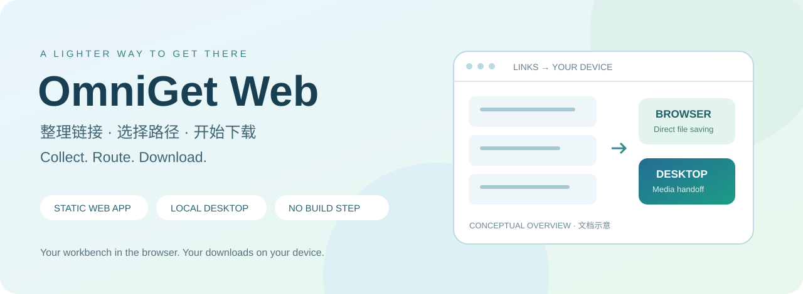

<div align="center">
  
  <h1>OmniGet Web</h1>
  <p><strong>Organize links in your browser. Download on your device.</strong></p>
  <p>链接在网页整理，下载由浏览器或本机完成。</p>
  <p><a href="README.md">简体中文</a> · <strong>English</strong></p>
  <p><a href="https://omniget.tarokiki.chatgpt.site">Live workbench</a> · <a href="#quick-start">Quick start</a> · <a href="#architecture">Architecture</a> · <a href="https://github.com/OpenSelena/omniget/releases/latest">Desktop downloads</a></p>
</div>



## One lightweight entry point. Two download paths.

OmniGet Web is an independent Sites web adaptation of [OmniGet](https://github.com/OpenSelena/omniget). No build toolchain is required: organize links, save direct files with your browser, or hand supported media tasks to the local OmniGet desktop application.

> **This is not a cloud download server or the full desktop app.** The desktop app controls platform extraction, output location, quality, format, and login state. Courses, Telegram, transcoding, transcription, and reading remain desktop features.

| Capability | What it does | Boundaries |
| --- | --- | --- |
| Link workbench | Single/batch paste, UTF-8 TXT import, platform detection, deduplication, status filters | Up to 50 queue items; TXT import limit: 128 KiB |
| Direct files | Save HTTP(S) files, show read progress, cancel transfers | Cross-origin sources must allow CORS; buffered saving is limited to 64 MiB |
| Disk streaming | Write directly to a local file without buffering the entire download | Shown only in top-level desktop browsers with a supported file picker |
| Desktop handoff | Send individual or batch tasks after pairing; use the `omniget:` URI fallback | A compatible local desktop app is required; accepted does not mean downloaded |
| Progress feedback | Display desktop tasks matched to links submitted from this page | Polls while connected and the page is visible; does not display the full desktop queue |
| Installer hub | List upstream Windows, macOS, and Linux release assets | Fetches GitHub live metadata, with a bundled fallback; digests appear only when supplied upstream |

## Quick start

### Save a direct file

1. Open the [live workbench](https://omniget.tarokiki.chatgpt.site), or run it locally below.
2. Paste a directly accessible file URL and add it to the queue.
3. Select **保存文件 / Save file**, or **流式保存 / Stream to disk** in a supported browser.
4. If the source rejects CORS or the link has expired, try **打开源文件 / Open source file**, or use the desktop app. The web app does not bypass source restrictions.

### Pair with local OmniGet

1. Install and launch **v0.15.1 or later** from [upstream Releases](https://github.com/OpenSelena/omniget/releases/latest).
2. In the desktop app, open **Settings → Plugins → Browser extension** and copy the local endpoint and pairing token.
3. Select **连接桌面端 / Connect desktop** in the web app and enter both values. Allow local-network access if your browser requests it and you wish to connect.
4. Add a media URL and select **发送到本机 / Send to local desktop**. The desktop app may still ask for an output directory or task confirmation.
5. If pairing is unavailable, **用桌面打开 / Open in desktop** hands off one task through the `omniget:` URI scheme.

**Local means the device running the browser.** A phone's `127.0.0.1` does not point to your computer. Do not expose the bridge port or pairing token to the public internet.

## Architecture


[Editable architecture source](docs/images/architecture.svg)

- **Static hosting:** Sites serves HTML, CSS, ES modules, and assets from `dist/`. There is no application backend proxying downloads.
- **Browser orchestration:** `app.mjs` manages UI and the task queue; `links.mjs` and `detect.mjs` parse and route URLs.
- **Direct-file path:** `download.mjs` reads the file origin directly, saving through a buffered Blob or a streaming file-system writer.
- **Desktop path:** `bridge.mjs` calls `/v1/health`, `/v1/enqueue`, and `/v1/queue` on `http://127.0.0.1:<port>`. Queue and enqueue calls use the Bearer pairing token.
- **Release metadata:** `releases.mjs` reads the latest GitHub release, falling back to `assets/releases.json`.

### Data and privacy

| Data | Where it lives or travels |
| --- | --- |
| URLs and task state, potentially including signed URLs | Current browser-session `sessionStorage`; memory only when storage is disabled |
| Pairing token | Page memory only; reconnect after refreshing |
| Media URLs and desktop token | Never pass through a Sites backend; sent to the local bridge when needed |
| Downloaded files | Read directly from their source by the browser or desktop app |
| Installer metadata | Browser requests the GitHub API, or reads the bundled fallback |

Removing a task from the web queue does not cancel a task already handed to the desktop app. If a submission receives no confirmation, check the desktop queue before retrying to avoid duplicates.

## Run locally

No npm install or build step is required. Start a static server with Python 3:

```sh
python3 -m http.server 8080 --bind 127.0.0.1 --directory dist
```

Open [http://127.0.0.1:8080](http://127.0.0.1:8080). Do not open the HTML directly with `file://`; browsers restrict module loading in that context.

### Deploy to Sites

Publish the `dist` directory. After registering your own Site, place the returned project ID in `.openai/hosting.json` at the repository root:

```json
{
  "project_id": "YOUR_SITE_PROJECT_ID",
  "static": { "directory": "dist" }
}
```

Never put personal tokens or real credentials in deployment configuration, documentation, or commit history.

## Repository map

```text
dist/
├── index.html          # Page structure
├── app.mjs             # UI, session queue, task orchestration
├── assets/
│   ├── site.css        # Responsive styles
│   ├── omniget.png     # Upstream app icon
│   └── releases.json   # Release fallback
├── lib/
│   ├── links.mjs       # URL parsing and routing
│   ├── detect.mjs      # Platform detection
│   ├── download.mjs    # Browser file saving
│   ├── bridge.mjs      # Local bridge and progress
│   └── releases.mjs    # Installer metadata
└── samples/            # Demo file
docs/images/            # README vector illustrations
```

## FAQ

**Why can't the browser read a file?**  
The source may reject CORS, require login, or serve an expired URL. Try opening the source file directly. This app does not proxy or bypass access controls.

**Why can't I connect to the desktop app?**  
Check that it is running a compatible version, the endpoint is correct, and local-network access is allowed. Copy a fresh token if it is invalid, and pair again after refreshing the page.

**Does “accepted by desktop” mean the download is complete?**  
No. It confirms the enqueue request. Download execution and any output-directory selection still happen in the desktop app.

**Does the web app download platform videos, HLS/DASH, or magnets itself?**  
No. It organizes and hands those tasks to the desktop app for extraction and downloading.

## Upstream and license

This is an independent web adaptation of [OpenSelena/omniget](https://github.com/OpenSelena/omniget), not a complete replacement for the desktop application. Upstream is maintained by **igect**, based on **Tonho**'s original architecture.

The web app uses the app icon, extension platform detection, download-unit formatting, and local APIs from upstream [`51d00c7`](https://github.com/OpenSelena/omniget/tree/51d00c75cf7bc339cf4e657a3b394a19968580fd). Desktop binaries continue to be released upstream. README illustrations are conceptual documentation graphics, not runtime screenshots.

Licensed under [GPL-3.0](LICENSE). Download only content you own or are authorized to obtain, and respect source-service terms.
