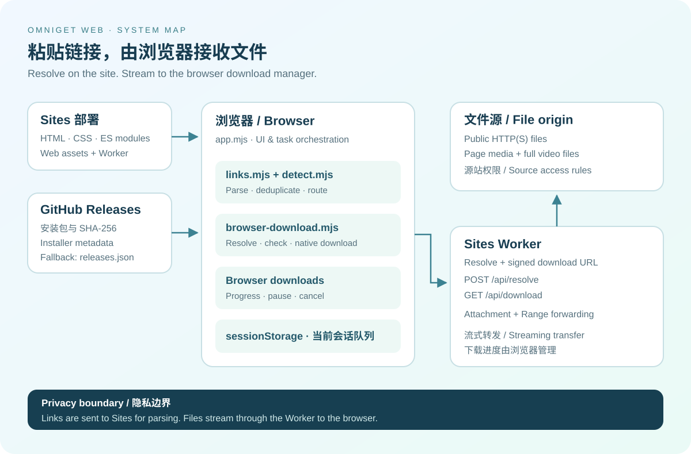

<div align="center">
  
  <h1>OmniGet Web</h1>
  <p><strong>Paste a link. Download with your browser.</strong></p>
  <p>粘贴链接，浏览器直接下载文件。</p>
  <p><a href="README.md">简体中文</a> · <strong>English</strong></p>
  <p><a href="https://omniget.tarokiki.chatgpt.site">Live workbench</a> · <a href="#quick-start">Quick start</a> · <a href="#architecture">Architecture</a></p>
</div>


## Download from the web

OmniGet Web adapts [OmniGet](https://github.com/OpenSelena/omniget) into a Sites download workbench. Paste an HTTP(S) URL and select **解析并下载 / Resolve and download**. The site retrieves the available file and hands it to your browser's download manager.

| Feature | Behavior |
| --- | --- |
| Direct files | Public HTTP(S) files, signed URLs and extensionless endpoints |
| Media pages | Extract full files from video/audio/source tags, Open Graph and JSON-LD |
| Bilibili | Public progressive video files, including the requested part; available quality depends on the source |
| YouTube | Direct complete audio/video URLs exposed in the page response; additional signatures or verification may prevent retrieval |
| Large files | Streamed through the Worker to the browser download manager without a whole-file page buffer |
| Multiple files and batches | Select a discovered file; import UTF-8 TXT or paste multiple links and download individually |
| Session queue | Deduplication, filters and up to 50 items in the current browser session |

Login, paid access, DRM, additional platform signatures and segmented-stream merging may prevent extraction. The web entry point accepts HTTP(S) URLs.

## Quick start

1. Open the [live workbench](https://omniget.tarokiki.chatgpt.site).
2. Paste a file or public media-page URL and select **解析并下载**. Use **试用示例 / Try example** to test the flow.
3. Check your browser download manager for actual progress, pause, cancellation and completion.
4. When a page provides multiple files, select one in the queue before downloading again.

The web queue's **已交给浏览器 / Handed to browser** state records submission. If the source URL expires or the transfer fails, resolve it again to obtain a fresh download URL.

## Architecture



| Module | Responsibility |
| --- | --- |
| `dist/index.html`, `app.mjs` | Inputs, session queue and download actions |
| `dist/lib/browser-download.mjs` | Resolve URL, check file and initiate a native browser download |
| `worker/app.mjs` | Public-address validation, extraction, signed download URLs and streaming |
| `POST /api/resolve` | Return downloadable files and short-lived download URLs |
| `GET /api/download` | Stream an attachment response, forwarding supported Range requests |
| `scripts/build.mjs` | Bundle the web assets into one Worker module |

### Data and privacy

| Data | Location |
| --- | --- |
| Queue links and state | Current browser-session `sessionStorage` |
| URLs to resolve | Sent to this site's Worker, which requests the public source |
| File bytes | Stream from the source through the Worker to the browser |
| Download signing key | Sites runtime Secret |
| Download URLs | Valid for two hours; resolve again after expiry |

Removing a web queue record leaves an active native download under the browser download manager's control.

## Run and deploy

Use Node.js 22 or later. No npm dependencies are required.

```sh
npm run dev
npm test
npm run build
```

The development server defaults to [127.0.0.1:3000](http://127.0.0.1:3000) and uses a local-only signing key.

For Sites, set your own project ID in `.openai/hosting.json`.

```json
{
  "project_id": "YOUR_SITE_PROJECT_ID"
}
```

Configure a runtime Secret named `DOWNLOAD_SIGNING_KEY` containing at least 32 characters. Build and publish `dist/server/index.js`. The Worker embeds the web assets and serves the same-origin extraction and download APIs.

## FAQ

**What if the file origin rejects browser CORS?**
The main flow forwards the file through this site. Source permissions, rate limits and access restrictions can still cause failure.

**Can it download every platform video?**
Extraction requires an accessible complete media file. Login, DRM, signatures or segmented media may prevent downloading and produce an error in the queue.

**Why does the queue say it was handed to the browser before the file finishes?**
The status records submission. Actual progress and completion appear in the browser download manager.

## Upstream and license

This is an independent web adaptation of [OpenSelena/omniget](https://github.com/OpenSelena/omniget). Upstream is maintained by **igect**, based on **Tonho**'s original architecture.

The web app uses the app icon, extension platform detection, download-unit formatting, and local APIs from upstream [`51d00c7`](https://github.com/OpenSelena/omniget/tree/51d00c75cf7bc339cf4e657a3b394a19968580fd). Desktop binaries continue to be released upstream. README illustrations are conceptual documentation graphics, not runtime screenshots.

Licensed under [GPL-3.0](LICENSE).
