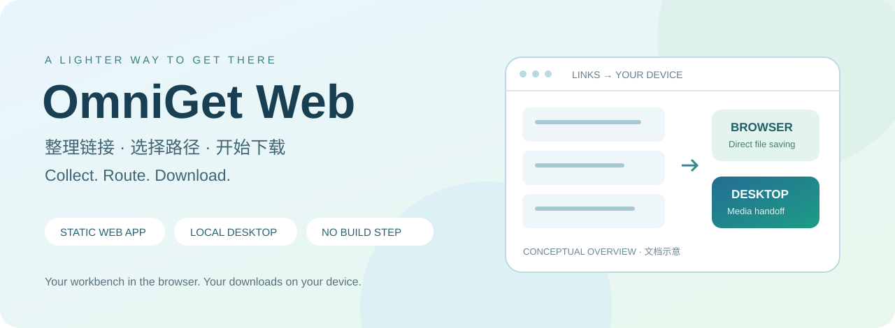
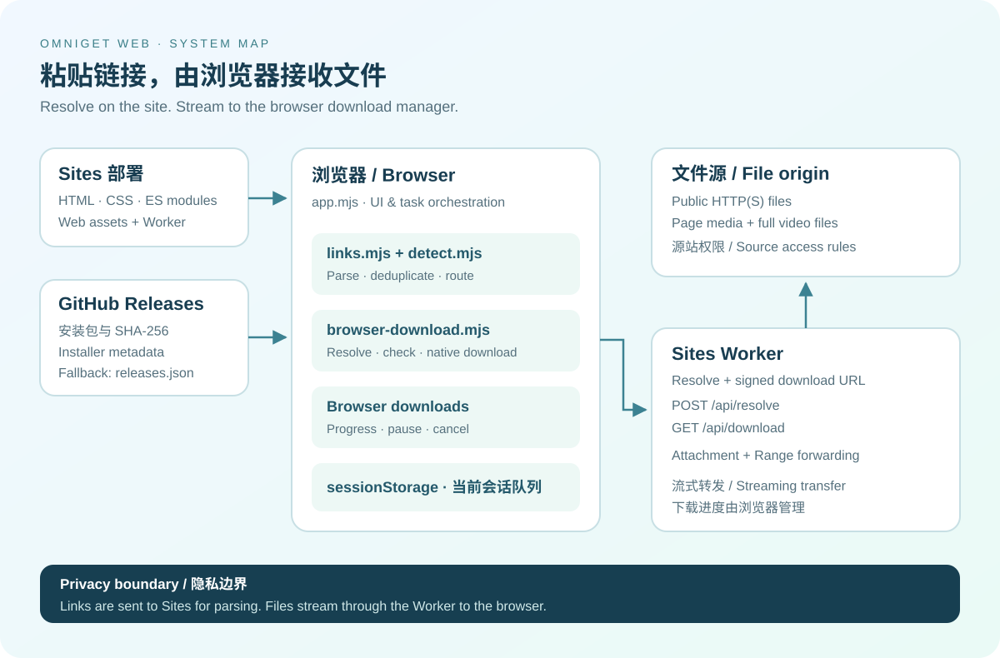

<div align="center">
  
  <h1>OmniGet Web</h1>
  <p><strong>粘贴链接，浏览器直接下载文件。</strong></p>
  <p>Paste a link. Download with your browser.</p>
  <p><strong>简体中文</strong> · <a href="README.en.md">English</a></p>
  <p><a href="https://omniget.tarokiki.chatgpt.site">在线体验</a> · <a href="#快速开始">快速开始</a> · <a href="#系统架构">系统架构</a></p>
</div>



## 网页直接下载

OmniGet Web 是 [OmniGet](https://github.com/OpenSelena/omniget) 的独立网页适配。粘贴 HTTP(S) 链接并点击 **解析并下载**，站点获取可下载文件后，直接交给浏览器的下载管理器。

| 能力 | 使用方式与范围 |
| --- | --- |
| 文件直链 | 公网 HTTP(S) 文件，包含签名地址和没有扩展名的文件接口 |
| 网页媒体解析 | 读取 HTML video、audio、source、Open Graph 和 JSON-LD 中的完整媒体文件 |
| B 站视频 | 通过当前 WBI 视频信息与播放接口获取公开视频，支持分 P；画质由源站实际返回值决定 |
| YouTube | 仅支持页面返回可直接读取的完整音视频地址的情况；需要额外签名或验证时显示失败原因 |
| 大文件 | Worker 流式转发，浏览器下载管理器接收；主下载流程无需把文件完整放进网页内存 |
| 多文件和批量 | 多媒体页面可选择文件；批量粘贴和 UTF-8 TXT 导入后，逐条发起下载 |
| 队列 | 去重、状态筛选、最多 50 项，保存在当前浏览器会话 |

需要登录、付费权限、DRM、额外签名或分片合并的内容可能无法处理。磁力链接使用 BitTorrent 协议，网页入口接受 HTTP(S) 地址。

B 站支持受源站访问限制影响：生产环境目前可能在获取播放器签名时收到 HTTP 412，此时不会发起下载。WBI 升级不能解除这一限制，也不保证所有公开视频可下载；页面会显示失败所在阶段。无需向本站提供 B 站 Cookie。

## 快速开始

1. 打开 [在线工作台](https://omniget.tarokiki.chatgpt.site)。
2. 粘贴文件或公开媒体页面链接，点击 **解析并下载**。也可以点击 **试用示例** 体验。
3. 在浏览器下载列表中查看实际进度、暂停、取消和完成状态。
4. 页面有多个文件时，在队列中选择目标文件，再点击 **浏览器下载**。

网页的「已交给浏览器」表示已提交下载。若源站返回过期地址或下载中断，点击 **重新解析下载** 获取新地址。

## 系统架构



| 模块 | 职责 |
| --- | --- |
| `dist/index.html`、`app.mjs` | 输入、会话队列和下载操作 |
| `dist/lib/browser-download.mjs` | 调用解析接口、检查源文件、触发浏览器原生下载 |
| `worker/app.mjs` | 公网地址检查、页面和平台解析、签名下载地址、流式转发 |
| `POST /api/resolve` | 返回可下载文件及限时下载地址 |
| `GET /api/download` | 使用附件响应向浏览器流式传输，按源站能力转发 Range 请求 |
| `scripts/build.mjs` | 将网页资源打包进单个 Worker 模块 |

### 数据与隐私

| 数据 | 保存或发送位置 |
| --- | --- |
| 链接、队列状态 | 当前浏览器会话的 `sessionStorage` |
| 待解析链接 | 发给本站 Worker，并请求链接指向的公网来源 |
| 文件内容 | 从源站经 Worker 流式传输给浏览器 |
| 下载签名密钥 | Sites 的运行环境 Secret |
| 下载地址 | 有效期两小时，刷新或过期后重新解析 |

删除网页队列记录后，已启动的原生下载仍由浏览器下载管理器控制。

## 本地运行与部署

使用 Node.js 22 或更新版本，无需安装 npm 依赖。

```sh
npm run dev
npm test
npm run build
```

本地默认地址为 [127.0.0.1:3000](http://127.0.0.1:3000)。开发服务器使用本地专用签名密钥。

部署到 Sites 时，项目根目录的 `.openai/hosting.json` 填入自己的项目 ID。

```json
{
  "project_id": "YOUR_SITE_PROJECT_ID"
}
```

在 Sites 运行环境中配置至少 32 字符的 Secret `DOWNLOAD_SIGNING_KEY`。执行构建后发布 `dist/server/index.js`。生成的 Worker 包含网页资源，使用同源接口完成解析与下载。

## 常见问题

**源站不允许浏览器跨域读取怎么办？**
主下载流程通过本站转发文件，浏览器访问同源下载地址。源站的权限校验、限流和访问限制仍可能导致下载失败。

**能下载任意视频链接吗？**
成功下载需要源站提供可获取的完整媒体文件。需要登录、DRM、签名验证或合并的内容可能返回具体失败原因。

**为什么队列已经显示「已交给浏览器」，但文件还没有保存完成？**
该状态只表示下载已提交，实际进度和结果请查看浏览器下载列表。

## 上游与许可证

本项目是 [OpenSelena/omniget](https://github.com/OpenSelena/omniget) 的独立网页适配。上游由 **igect** 维护，基于 **Tonho** 的原版架构。

网页使用上游 [`51d00c7`](https://github.com/OpenSelena/omniget/tree/51d00c75cf7bc339cf4e657a3b394a19968580fd) 的应用图标、扩展平台检测、下载单位格式和本机接口；桌面构建产物仍由上游发行。README 配图是文档示意图，不是运行截图。

本项目使用 [GPL-3.0](LICENSE)。
